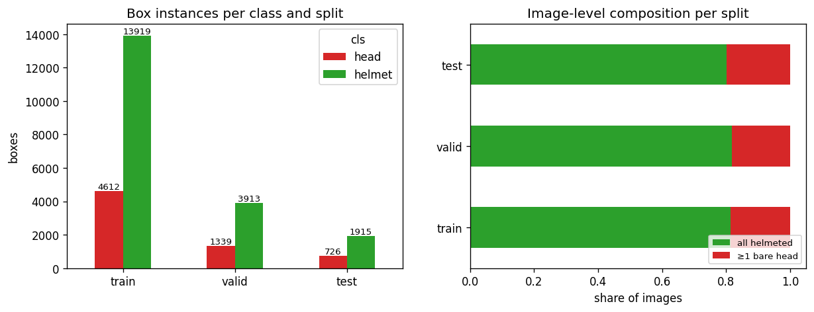
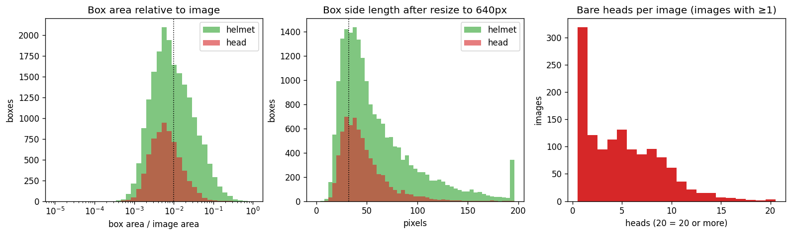
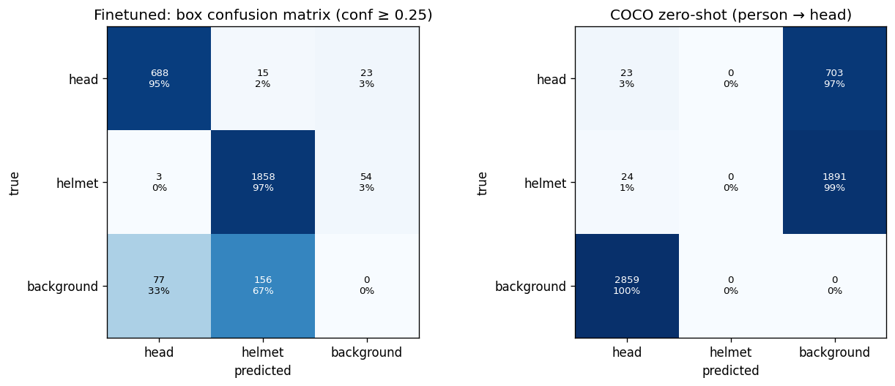
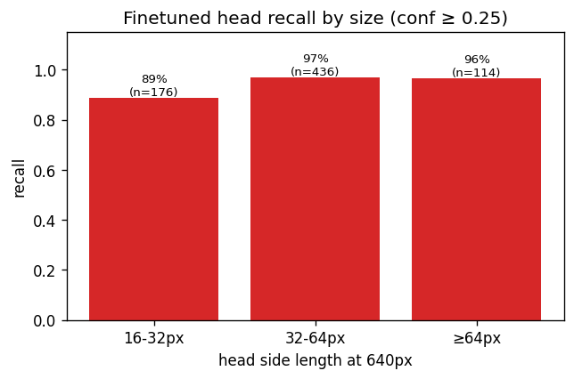
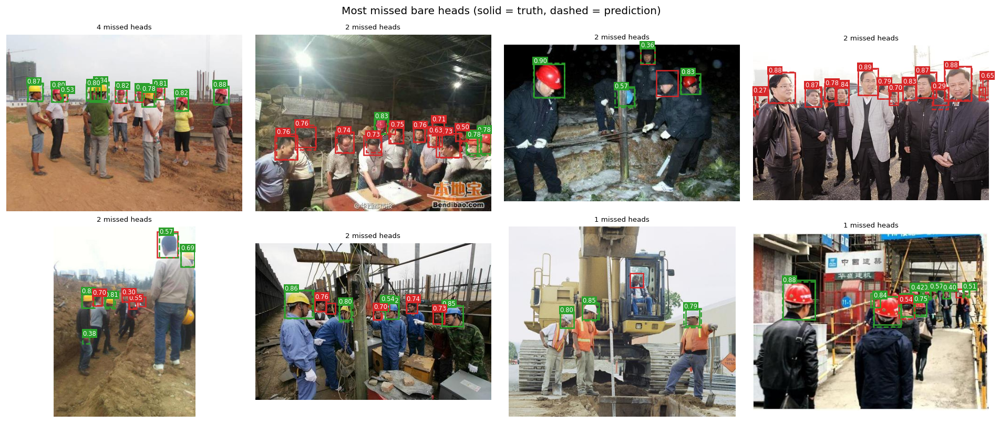
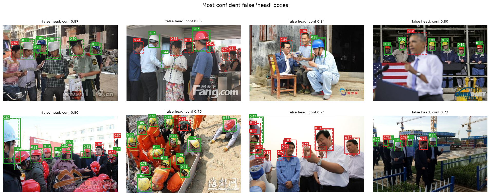
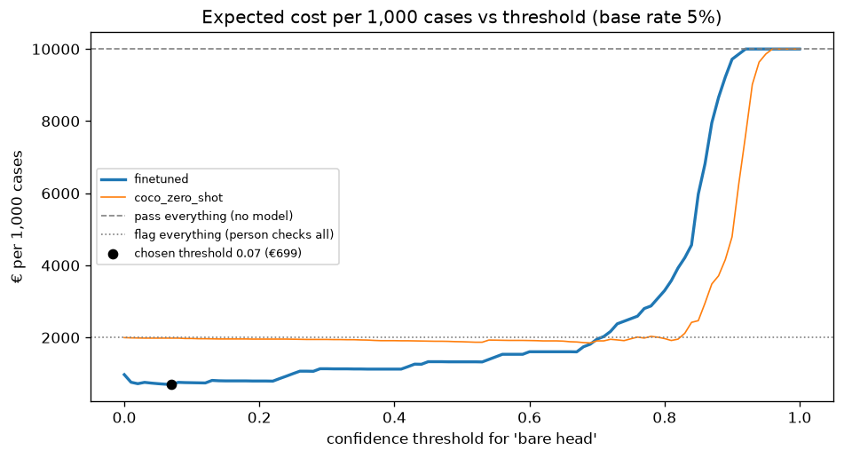
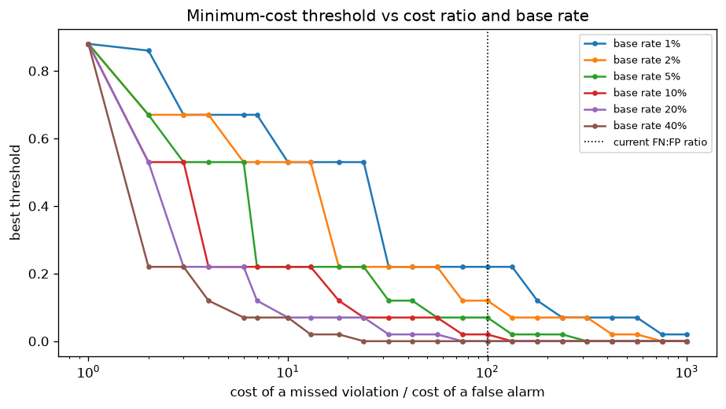
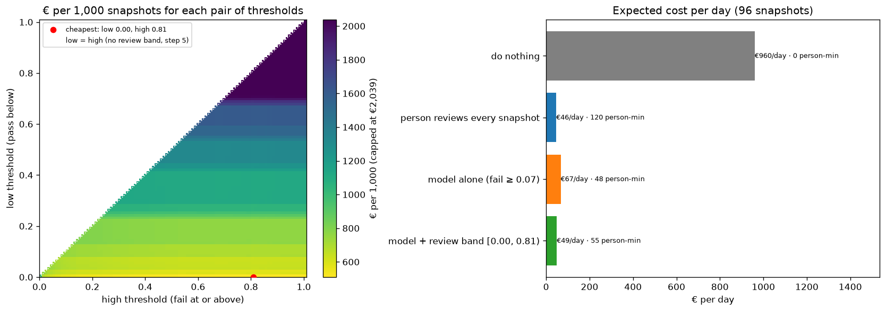
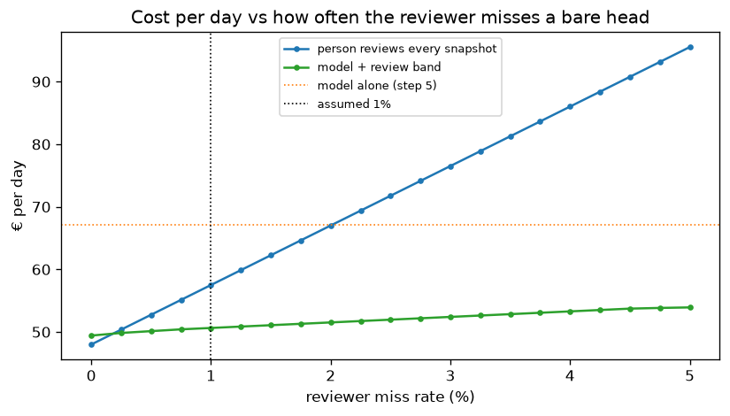

# Assignment 2 Report

- **Name**: Pilar Guerrero
- **Student ID**:
- **Email**:
- **Group**: [BBADBA 5A | BBADBA 5B | PPLEDBA 5A | BDBA 3A]

## Business problem, and the cost of being wrong

On a construction site someone has to make sure every worker is wearing a hard hat. As a matter of fact my research with claude showed that this is currently a job of a safety technician, who walks around the site or watches the camera feed and whose role is basically controlling for helmet wear. The model I built supports exactly that decision. A camera takes a snapshot of a work area every 5 minutes, the model looks for heads without a helmet, and the snapshot either passes, goes to the technician to check on a screen, or sends the technician straight to the worker. One case is therefore one snapshot, and its score is the highest "bare head" confidence the model finds in it. The positive class is `head`, a worker without a helmet.

The two mistakes cost very different amounts. A false positive, flagging a snapshot where everyone has a helmet, only wastes a check. From my research, a technician in Spain earns around €30k gross a year, and including about 32% employer social security that is roughly €40k a year over about 1,750 working hours, so around €23 an hour. A check takes about 5 minutes, which makes a false alarm cost about €2. These are all informed assumptions in my model. Catching a real violation costs the same €2 check. 

A false negative, missing a worker without a helmet, is the expensive one, and I put it at €200. A missed bare head doesn't cause an accident by itself, it just leaves the risk there until the next check, so I value it as an expected cost rather than as the cost of an accident. A serious head injury costs a company around €200,000 between sick leave, cover, insurance and claims, and I assume a 1/1,000 chance that it happens in that unprotected window, so 0.001 × €200,000 = €200. Again this is an assumption for the purposes of modelling this.

In cost relations a miss costs 100 times a false alarm. Therefore inherently the system should be quick to flag, because looking at a photo for nothing is cheap and missing someone without a helmet is not. That means I care more about recall on bare heads than about precision, and I expect the cheapest threshold to come out low. The model has to be very good for us to actually want to delegate this important decision.

## Dataset

I used the Roboflow Universe workspace `joseph-nelson`, project `hard-hat-workers`, more specifically version 5 (`raw_HeadHelmetClasses`), as published: https://universe.roboflow.com/joseph-nelson/hard-hat-workers/dataset/5.

As a summary, it is public domain. Each image is a photo of people on or around a work site (construction, power lines, some visits), and every head has a box labelled either head (no helmet) or helmet. The nature of this data makes it an object detection dataset with two classes, and the background acts as the free negative class.

The dataset serves the problem and doesn't just resemble it, because the labels answer exactly the question the technician asks as we framed it in the business problem section: is anyone in this picture not wearing a helmet? It is important to address that there is class imbalance, about 80% of the images are fully compliant scenes.

## What the dataset's composition implies

| Split | Images | `head` boxes | `helmet` boxes | Images with ≥1 bare head |
|---|---|---|---|---|
| Train | 4,916 | 4,612 | 13,919 | 911 (18.5%) |
| Valid | 1,413 | 1,339 | 3,913 | 256 (18.1%) |
| Test | 706 | 726 | 1,915 | 140 (19.8%) |
| **Total** | **7,035** | **6,677** | **19,747** | **1,307** |

At box level the numbers are big enough to be significant and show an actual signal to the model. There are 726 bare heads and 1,915 helmets in the test split. Although there are about three helmets for every bare head, both classes are still large and this imbalance is also something the model will face in real life, as usually there will be more compliant workers than violations.

The three splits are also consistent with each other, each with around 18–20% of images containing a violation, so the test result should reflect what the model did on validation.

The image-level picture is thinner. Only 140 test images contain a violation. Also, the 20% share of violation images is not the real world. It comes from how the dataset was collected, and a supervised site will have far fewer, which is why I don't use it as the base rate.

Another important mention is that the objects are small. The median head box covers only 0.6% of the image (0.8% for helmets), and most head boxes are under 1% of the image. The images themselves are small too, with a median of 500 × 333 px and 95% of them at 640 px or less on the long side, so resizing to 640 for training slightly enlarges them and nothing is lost.

The biggest caveat is that the test split doesn't look like it would in production, e.g. a real camera. Many of the images are news photos with watermarks, officials in suits visiting sites, or close-ups and some of them have people looking and posing directly at the camera. Not all of them of course, some are more true to production. A real site camera is fixed, higher up, wider, and sees the same scene all day, including at night. So from these results I can say how well the model works on photos like these, but not how well it would work on an actual CCTV feed.

## Finetuning and baselines

I treated it as object detection and fine-tuned yolo11n starting from the COCO weights. Detection fits better than classification because the decision depends on finding each individual head, even one small head in a crowd, and the dataset comes with boxes rather than image labels. I chose the nano model because it is fast and cheap enough to run on a site camera, and it turned out to be more than enough to beat both baselines.

I trained on Google Colab with a free Tesla T4 GPU, since the same run would have taken around 7 hours on my laptop. The settings were 50 epochs, early stopping patience of 15, which never triggered, image size 640, batch 16 and seed 0, with Ultralytics 8.4.187, and it took around an hour. The best epoch, picked on the valid split, is saved as `weights/hardhat_yolo11n.pt`.

Validation mAP50 was already 0.925 after the first epoch, this is because we were fine-tuning and the COCO starting point already knows what people look like. As we can see from the curves, it then climbed to 0.972 and flattened out around epoch 38. The model trains on three losses. The box loss measures how far the predicted boxes are from the real ones, the classification loss measures how wrong the "bare head or helmet" guess is (the part my problem depends on most), and the DFL loss measures how sharp the box edges are. All three went down and flattened, so there was no sign the model was still learning much by the end.

All three models were scored on the same 706 test images with the same matching code, where a box counts as correct if it has the right class and overlaps a real box with an IoU of at least 0.5.

| Model | head AP50 | helmet AP50 | mAP50 | mAP50-95 |
|---|---|---|---|---|
| **Fine-tuned yolo11n** | **0.958** | **0.983** | **0.970** | **0.692** |
| COCO yolo11n, zero-shot | 0.007 | 0.000 | 0.003 | 0.001 |
| Predict nothing | 0 | 0 | 0 | 0 |

COCO has no head or helmet class, so for the zero-shot baseline I read its person boxes as head, a person it can't vouch for. I expected it to score close to zero, because a person box covers the whole body and it has no way of telling a helmet from a bare head. That is what happened, with an AP50 of 0.007. Interestingly, COCO actually drew far more boxes than my model, 41,477 against 9,058 on the test set when counting even very unsure guesses. That doesn't mean it found more. It spreads a lot of weak "person" guesses over every image, and 2,859 of its more confident boxes landed on background, so the number of boxes says nothing about quality.

The predict-nothing baseline never flags anything. At image level it would be "right" 80% of the time, simply because 80% of the test images are compliant, but it catches zero violations, which shows how misleading accuracy would be here. The gap between the fine-tuned model and both baselines is as big as I expected. Fine-tuning is what makes the model useful at all, since the pretrained model on its own is no better than the trivial baseline for this task.

## Per-class evaluation and failure modes

The positive class is head, a worker without a helmet. Counting only the boxes the model is at least 25% sure about, bare heads have a precision of 0.896 and a recall of 0.948, with an AP50 of 0.958 and an AP50-95 of 0.687. Helmets do better on everything, with a precision of 0.916, a recall of 0.971, an AP50 of 0.983 and an AP50-95 of 0.697. This is probably because there are more of them in the dataset. So the headline mAP50 of 0.970 is pulled up by helmets, which is the easier and much bigger class. Bare heads are the class that matters for my problem and the weaker one, and at 0.25 the model still misses about 5% of them. 

| True \ predicted | head | helmet | background (missed) |
|---|---|---|---|
| **head** | 688 (95%) | **15 (2%)** | **23 (3%)** |
| **helmet** | 3 | 1,858 (97%) | 54 (3%) |
| **background** (false box) | 77 | 156 | n/a |

The confusion matrix shows what it misses. Of the 726 bare heads, 23 were missed completely and 15 were labelled as helmets. From further digging, size is the clearest pattern: recall for bare heads of 16 to 32 px is 88.6%, against 96.8% for 32 to 64 px and 96.5% for anything bigger, which is the small-object problem the dataset analysis predicted. 

The false heads tell a different story. When I looked at the most confident false head boxes, several of them are clearly real bare heads that the annotators simply didn't label, like two men reading on a bench, a speaker at a podium, or people in a crowd. So part of the 77 false heads is label noise rather than model error, and the real precision is probably higher than measured due to data labelling limits.

## Cost matrix and operating point

The costs are the ones from the first section: €2 for a false positive and for a true positive (a 5-minute check at about €23 an hour), €0 for a true negative, and €200 for a false negative (a 1-in-1,000 chance of a €200,000 head injury). For the base rate I assume that about 5% of snapshots on a real site, 1 in 20, show someone without a helmet. The dataset has 20%, but only because whoever built it collected a lot of violations to have variability. On a supervised site I'm assuming most workers wear their helmet most of the time, with a few taking it off for a break or a quick job, so there are only some violations. 

To pick the threshold, a test snapshot counts as flagged if its highest bare head confidence is at or above it. I swept the threshold from 0 to 1 and computed the expected cost per 1,000 snapshots at every step. The cheapest point is a threshold of **0.07**, at **€699 per 1,000 snapshots**.

The threshold is so low because of the 100:1 asymmetry in cost. It means the system flags a snapshot at even a small hint of a bare head, so it is strict about safety and relaxed about false alarms. At 0.07, bare-head recall goes up from 0.948 to 0.963 and precision goes down from 0.896 to 0.803, and that is exactly the trade my costs ask for. 

The cheapest threshold depends only on the 100:1 cost ratio and the base rate, so it would rise to 0.22 if only 1% of snapshots had a violation and drop to almost 0 at 10% or more, which makes the base rate the assumption that matters most.

## What a person still has to check

I added a review step with two thresholds. Below the low one a snapshot passes and nobody looks. Between the two, the technician checks the photo on a screen for 1 minute (about €0.40) and only walks over if it is real, missing 1% of the violations they see. Above the high one the technician is sent straight away (€2). For the site I assumed one camera, a snapshot every 5 minutes and an 8-hour day, so 96 snapshots a day.

The cheapest pair is a low of **0.00** and a high of **0.53**, at €528 per 1,000 snapshots. In practice this means a photo only passes when the model draws no bare-head boxes at all. This sends about 28 photos a day to review, which together with the walks to workers is around 56 minutes of the technician's day. That is realistic, since the technician already on site can absorb it.

| Design (per day, 96 snapshots) | € per day | Violations missed | Person-minutes | People needed |
|---|---|---|---|---|
| Do nothing | €960 | 4.8 | 0 | 0 |
| Person reviews every snapshot | €57.50 | 0.05 | 120 | 0.25 |
| Model alone (fail ≥ 0.07, no review) | €67.11 | 0.24 | 48 | 0.10 |
| **Model + review band (0.00 / 0.53)** | **€50.64** | 0.14 | 56 | 0.12 |

The model with a review band is the cheapest option and uses less than half the time of a person checking everything. This depends on the reviewer not being perfect. A previous attempt showed that if, hypothetically, the human reviewer never missed anything, reviewing every snapshot would be marginally cheaper, but as soon as they miss more than about 0.25% of bare heads the model wins, and the gap grows quickly. Adding a human failure rate was a methodological change that makes the results more realistic. 

## Limitations & next steps

The most important methodological limitation is that I chose the thresholds and evaluated them on the same test split. Picking the best threshold on the data you then score makes the €699 and €528 slightly optimistic. With more time I would choose the thresholds on the valid split and only report the cost on the test split.

The data itself has two problems. Some of the false heads are real heads that were never labelled, so relabelling at least the most confident false positives would give a fairer precision, as already discussed. Also, most of the images are news photos rather than CCTV, so before trusting any of these numbers on a real site I would collect a few days of footage from an actual site camera, label a sample, and check and fine-tune the model on that.

The cost model is simpler than reality too. Snapshots are not independent, because a worker without a helmet usually appears in several snapshots in a row, so missing one snapshot doesn't always mean missing the violation, and my €200 per missed snapshot is probably on the high side. These would need to be adjusted to reality with more information on the site's costs. 

## Generative AI use disclosure

I worked in Visual Studio Code and had a window with Claude open with access to my project. I walked through it with its assistance. We iterated through key decisions in a conversation e.g. for the business case we brainstormed together what the best costs would be, and I even used it as a research tool to look up reference wages in Spain when assigning the costs. In terms of code it helped me a lot with the writing of it following my instructions, and I reviewed it. It was also very useful to produce the tables. It built the app.py dashboard entirely, following my instructions on what I wanted to compare. In terms of the report, I asked it to draw from our conversations to do a write-up of the key decisions we agreed on together and based on that I iterated through it with my own thoughts. I finally asked it to check through the grammar and structure of everything and fix for coherence.
